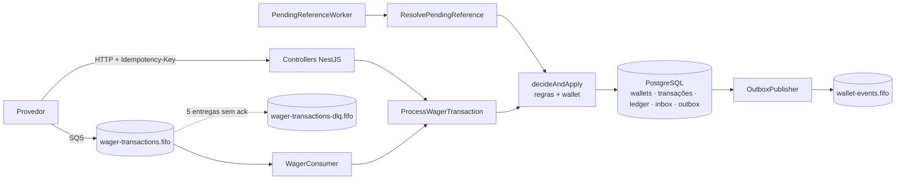

# Arquitetura e decisões

Este documento explica **como** o serviço garante as invariantes do desafio e **por que** cada decisão foi tomada. O processo completo, incluindo os bugs encontrados e como foram investigados, está em [docs/DIARIO.md](docs/DIARIO.md).

**Invariantes globais:** não duplicar crédito nem débito, não perder evento confirmado, nunca ter saldo negativo, com mensagens duplicadas, fora de ordem e concorrentes, e com várias instâncias.

**Princípio que guia tudo:** as garantias moram no **PostgreSQL** (constraints, locks de linha, unique, trigger). Ele é o único ponto compartilhado por todas as instâncias. O código da aplicação valida antes por clareza e mensagens melhores, mas a última palavra é do banco.

---

## 1. Visão geral



| Camada | Conteúdo | Depende de |
|---|---|---|
| `domain/` | `Money`, `Wallet`, `WagerTransaction`, `WalletLedgerEntry`, `InboxMessage`, `OutboxMessage`, eventos, `FailureCode` | só `decimal.js` (sem Nest, sem ORM) |
| `application/` | casos de uso + a **porta** `WagerStore` (interface) | domínio |
| `infrastructure/` | adaptador MikroORM, outbox publisher, consumidor SQS, worker, logs e métricas | aplicação, MikroORM, AWS SDK |
| `http/` | controllers, filtro de erros, `AuthGuard` | aplicação |

O HTTP, a fila e o worker de pendências usam **a mesma** função de regras (`decideAndApply`). Não existe cópia de regra de negócio.

---

## 2. ORM e persistência

**MikroORM 7** (o preferencial do enunciado), usado com `em.fork()` (Identity Map por execução), `em.transactional()`, Unit of Work e `LockMode`.

**Mapeamento: "records" + conversor, fora do domínio.**
- Classes só de persistência (`WalletRecord`, `WagerTransactionRecord`…), com campos públicos que espelham as colunas, mapeadas por `EntitySchema`, sem decorators.
- O adaptador `PostgresWagerStore` converte record ↔ domínio usando as factories `rehydrate`.

Alternativas descartadas:
- **`EntitySchema` direto nas classes do domínio.** O `Money` ocupa duas colunas (valor + moeda), e os tipos customizados do MikroORM convertem uma coluna por vez. Além disso, o estado do domínio fica em campos privados (`_balance`, `_status`). Mapear isso exigiria embeddables e configuração frágil, e o domínio passaria a depender do ORM.
- **SQL escrito à mão no adaptador.** É mais simples, mas abre mão do que o enunciado valoriza no MikroORM (Unit of Work, Identity Map, `LockMode`).

**Migrations escritas à mão em SQL** (3 arquivos, todos com `up` e `down`). O gerador automático do MikroORM não expressa o que é avaliado: CHECKs com regra de negócio, unique parcial, FK composta e trigger. Mudança de schema é sempre uma migration **nova**: uma migration já aplicada nunca é editada.

---

## 3. Dinheiro (`Money`)

- **Nunca `number`.** O `Money` encapsula um `Decimal` (`decimal.js`) e é imutável: toda operação devolve uma nova instância.
- **Contrato de entrada:** string com **exatamente 2 casas** (`/^\d{1,18}\.\d{2}$/`). Isso já rejeita `NaN`, `Infinity`, notação científica, string vazia, negativos, vírgula e mais de 2 casas. **Nada é arredondado**: `"10.005"` é entrada inválida (400). Arredondar dinheiro sem avisar é decisão de negócio, não detalhe técnico.
- **Duas armadilhas do `decimal.js`, evitadas e testadas:**
  1. `isPositive()` devolve `true` para zero, então usamos `gt(0)`.
  2. A precisão padrão é de 20 dígitos significativos, o que arredondaria em silêncio somas grandes. Usamos `Decimal.clone({ precision: 40 })`, e a entrada é limitada a 18 dígitos inteiros.
- **No banco:** `NUMERIC(20,2)` + `CHAR(3)` para a moeda. O driver devolve o `NUMERIC` como **string**, que é convertida em `Money` sem passar por `number`.
- **Nos eventos e na API:** `{ "amount": "25.00", "currency": "BRL" }` (`MoneyProps`), nunca a instância.
- **Multi-moeda:** o modelo é multi-moeda (uma wallet por jogador **e** moeda). Operar com outra moeda resulta em `CURRENCY_MISMATCH` (testado). Todo o desafio roda com BRL.

---

## 4. Garantias no schema

| Garantia | Como está no banco |
|---|---|
| Uma wallet por jogador e moeda | `UNIQUE (player_id, currency)` |
| Saldo nunca negativo | `CHECK (balance >= 0)` na wallet; `CHECK (balance_before >= 0 AND balance_after >= 0)` no ledger |
| Idempotência | `UNIQUE (idempotency_key)` e `UNIQUE (provider_id, external_transaction_id)` |
| No máximo um lançamento por transação e wallet | `UNIQUE (transaction_id, wallet_id)` |
| Ledger imutável | trigger `BEFORE UPDATE OR DELETE` (por linha) e `BEFORE TRUNCATE` que lançam erro |
| Aritmética do lançamento | `CHECK (balance_after = balance_before ± amount)` conforme a direção |
| Moeda do lançamento = moeda da wallet | FK composta `(wallet_id, currency) → wallets(id, currency)` |
| Uma reversão por referência | `UNIQUE (reference_transaction_id) WHERE kind IN ('REFUND','ROLLBACK')` (ver §10) |
| Inbox | `PRIMARY KEY (consumer_name, message_id)` |
| Estados coerentes | `CHECK`s: REJECTED/FAILED exigem `failure_code`; PROCESSED exige `processed_at`; REFUND/ROLLBACK exigem referência; `kind` e `status` só com valores válidos; `amount > 0` |

Há 25 testes de integração que violam cada garantia de propósito e conferem o código SQLSTATE e o nome da constraint.

---

## 5. Estratégia transacional e de concorrência

**Unidade de concorrência: a wallet.** Todo o processamento de uma transação acontece numa **única transação SQL**:

```
BEGIN; SET LOCAL lock_timeout = '5s'
→ [inbox, se veio da fila]
→ SELECT … FROM wallets WHERE id = ? FOR UPDATE      -- LockMode.PESSIMISTIC_WRITE
→ checa a idempotência (DEPOIS do lock)
→ regras → debita/credita a wallet (saldo + version + lançamento mudam juntos)
→ INSERT transação · UPDATE wallet · INSERT ledger · INSERT outbox
COMMIT
```

- **Lock pessimista de linha, não lock global.** Só a wallet envolvida espera; as outras wallets seguem em paralelo. Funciona entre processos, porque quem segura o lock é o Postgres.
- **Por que pessimista, e não otimista com retry?** Numa wallet "quente", o otimista faz quase todo mundo falhar e repetir (tempestade de retries). O pessimista põe as transações em fila e resolve de primeira. O custo é a espera, limitada pelo `lock_timeout` (5s). Passou disso, a transação vira falha transitória (503 / retry da fila) e é contada em métrica.
- **Idempotência checada depois do lock:** duas cópias concorrentes da mesma requisição entram em fila no lock. Quando a segunda passa, a primeira já fez commit, e ela vira replay.
- **Sem deadlock por construção:** o caminho normal trava **uma** linha. O worker de pendências trava a transação pendente e depois a wallet, e ninguém faz o caminho inverso.
- **`version`** começa em 1 e só incrementa quando o saldo muda. Com lock pessimista, ela não é usada para controle de concorrência; fica como auditoria (pedido do enunciado).
- **Caminho sem lock (wallet inexistente):** não existe linha para travar. Cópias concorrentes podem chegar juntas. A unique constraint barra a segunda, e o caso de uso repete uma vez, virando replay. Também tratamos uma corrida real que achamos em teste: um commit concorrente acontecendo **entre** duas consultas (detalhe no diário, Fase 4).
- **Workers com várias instâncias:** o outbox publisher e o worker de pendências usam `SELECT … FOR UPDATE SKIP LOCKED` (`LockMode.PESSIMISTIC_PARTIAL_WRITE`). Cada instância pega linhas diferentes, sem esperar.

**Prova:** removendo o lock de propósito, os testes de concorrência falham com lost update (`balance 30.00 != ledger 15.00`). Removendo o `SKIP LOCKED`, dois publishers enviam 60 mensagens para 30 eventos, e dois workers sobrescrevem um REFUND já aplicado. Com 3 processos reais, 30 apostas de 7.00 numa wallet de 100 dão exatamente 14 aplicadas.

---

## 6. Idempotência e hash do payload

- **Fonte da verdade:** o header `Idempotency-Key` (no SQS, `data.idempotencyKey`). Ele é persistido com `UNIQUE`, **nunca** guardado em memória.
- **`payloadHash` = SHA-256 (hex) do JSON canônico** (chaves ordenadas recursivamente) de: `providerId`, `externalTransactionId`, `playerId`, `walletId`, `roundId`, `gameId`, `kind`, `money` (normalizado: `"025.00"` vira `"25.00"`) e `referenceExternalTransactionId`. A key e os metadados de transporte (headers, `messageId`, `occurredAt`) **não** entram.
- **Mesma key + mesmo hash = replay.** A resposta é o **resultado original**, inclusive o **saldo observado naquele momento**, guardado na transação (`observed_balance_amount` + `observed_balance_currency`). O guardado é necessário porque LOSS e rejeições não geram lançamento no ledger. A moeda tem coluna própria porque, em `CURRENCY_MISMATCH`, o saldo está na moeda da wallet.
- **Mesma key + hash diferente** = `409 IDEMPOTENCY_CONFLICT`. O mesmo `externalTransactionId` com outra key também é conflito.
- **Rejeições também são gravadas** (a key fica "queimada"): reenviar uma transação rejeitada devolve a mesma rejeição. Isso vale inclusive para `WALLET_NOT_FOUND` (ver §10).
- **Na fila:** além disso, o inbox `(consumer_name, message_id)` é gravado na mesma transação do efeito.

---

## 7. Estados e transições

```
PENDING ──► PROCESSED | REJECTED | FAILED | PENDING_REFERENCE
PENDING_REFERENCE ──► PROCESSED | REJECTED | FAILED
PROCESSED, REJECTED, FAILED: terminais
```

- Uma transição a partir de um estado terminal lança `InvalidTransactionStateError`: é bug no código, não regra de negócio.
- `rehydrate` reconstrói o estado do banco **sem** revalidar transições.
- Construtores são privados; as factories são `create` (entrada do provedor, nasce `PENDING`), `opening` (interna) e `rehydrate`.
- `OPENING` é interno: pela API ou pela fila, é recusado como entrada inválida.
- `FAILED` está modelado e permitido no schema, mas nenhum fluxo atual chega nele. Falhas de infraestrutura são tratadas como transitórias (retry), e não gravadas.

**Regras por tipo:**

| Tipo | Efeito | Referência |
|---|---|---|
| `BET` | débito | não pode ter |
| `WIN` | crédito | opcional (só `BET`) |
| `LOSS` | nenhum: `PROCESSED` sem lançamento e sem `WalletBalanceChanged` | não pode ter |
| `REFUND` | crédito igual ao da `BET` | obrigatória, só `BET` |
| `ROLLBACK` | inverso da referência | obrigatória: `BET`, `WIN` ou `REFUND` |

A referência precisa ser do mesmo provider, jogador, wallet, moeda e rodada, e ter o **mesmo valor** (reversão parcial está fora do escopo).

---

## 8. Códigos de falha (`failureCode`)

Todos são rejeições de negócio **terminais**: reenviar o mesmo payload devolve o mesmo resultado.

| Código | Quando |
|---|---|
| `INSUFFICIENT_FUNDS` | BET maior que o saldo |
| `REVERSAL_WOULD_OVERDRAW` | ROLLBACK de um crédito (WIN/REFUND) que já foi gasto. É distinto de `INSUFFICIENT_FUNDS` porque são situações operacionais diferentes, e a segunda pede investigação |
| `WALLET_NOT_FOUND` | `walletId` inexistente |
| `WALLET_PLAYER_MISMATCH` | a wallet existe, mas é de outro jogador (bug ou fraude no provedor) |
| `CURRENCY_MISMATCH` | moeda diferente da wallet ou da referência |
| `REFERENCE_NOT_FOUND` | a referência não chegou dentro do limite de tentativas (§11) |
| `REFERENCE_NOT_PROCESSED` | a referência existe, mas foi rejeitada |
| `REFERENCE_MISMATCH` | a referência é de outro provider, jogador, wallet ou rodada |
| `INVALID_REFERENCE_KIND` | REFUND que não aponta para BET; ROLLBACK que não aponta para BET/WIN/REFUND |
| `AMOUNT_MISMATCH` | valor diferente do valor da referência |
| `ALREADY_REVERSED` | a referência já tem uma reversão aplicada |

---

## 9. Mapeamento HTTP

Um único `ExceptionFilter` traduz erro em status, então o mapeamento é o mesmo em todos os endpoints. O corpo de erro traz `error`, `message` e **`retryable`**, para o provedor decidir sem interpretar texto.

| Situação | Status | `retryable` |
|---|---|---|
| processado / wallet criada | 200 / 201 | — |
| aceito aguardando a referência | 202 | — |
| payload inválido (formato, campo, header, JSON) | 400 | não |
| recurso inexistente (consultas) | 404 | não |
| conflito de idempotência / wallet duplicada | 409 | não |
| rejeição de negócio (`failureCode`) | 422 | não |
| falha transitória (conexão, `lock_timeout`, deadlock, Postgres reiniciando) | 503 | **sim** |

No 409 de wallet duplicada, o corpo traz o `walletId` da wallet que já existe. Criar wallet não tem idempotency key, então um cliente que reenvia o `POST /wallets` depois de um timeout recupera o id por aqui.

O replay devolve **o mesmo status** da primeira vez ("requisição idêntica → mesma resposta"); quem diferencia é `idempotentReplay`. Por isso uma transação processada é `200`, e não `201`.

---

## 10. Interpretações adotadas (onde o enunciado deixa espaço)

1. **Uma referência só pode ser revertida uma vez, por qualquer tipo.** O enunciado proíbe reverter duas vezes "pelo mesmo tipo"; ao pé da letra, uma BET poderia receber REFUND **e** ROLLBACK, creditando duas vezes. A regra adotada é mais rígida e continua cumprindo a do enunciado. ROLLBACK de um REFUND continua permitido, porque a referência é outra.
2. **Wallet inexistente é gravada como `REJECTED / WALLET_NOT_FOUND`** em vez de ser rejeitada sem gravar. Assim o reenvio devolve a mesma resposta, HTTP e fila se comportam igual, e fica auditável. Por isso `wager_transactions.wallet_id` **não tem FK**. A segurança não depende dela: o ledger tem FK para a wallet, e dinheiro não se move sem lançamento.
3. **Valor sempre maior que zero** em transações (empate chega como `WIN` com o valor devolvido). Só o **saldo** pode ser zero.
4. **Valor com exatamente 2 casas**, sem arredondamento (§3).
5. **Referência que existe mas ainda não foi decidida** (PENDING/PENDING_REFERENCE) leva a transação a **esperar**, não a ser rejeitada.
6. **Replay de uma transação que estava pendente** devolve o estado final decidido pelo worker (PROCESSED ou REJECTED), não o 202 original. É a informação de que o provedor precisa.
7. **Abertura de wallet:** saldo inicial > 0 gera uma transação `OPENING` (provider `internal`), com lançamento CREDIT e eventos, na mesma transação SQL, e a wallet nasce com `version = 1`. Wallet aberta com 0 não gera transação.
8. **Conflito de idempotência vindo da fila vai para a DLQ** (não só ack): é erro do provedor que precisa de investigação.

---

## 11. Mensageria e recuperação

### Transactional Outbox
- Os eventos são gravados na **mesma transação** da mudança financeira e publicados **depois do commit** pelo `OutboxPublisher` (a cada 500 ms, em lotes de 10, com `SKIP LOCKED`).
- **Entrega at-least-once.** Se o processo morrer entre o `SendMessage` e o commit, o evento sai de novo. O id da mensagem é o `eventId` (o consumidor deduplica por ele), e o `MessageDeduplicationId` do SQS também é o `eventId` (otimização).
- `MessageGroupId = aggregateId`: ordem por wallet ou transação.
- **SQS fora do ar:** backoff exponencial de 1s até 5 min, **sem limite de tentativas**. Evento confirmado no banco não pode ser descartado; o atraso aparece em `outbox_lag_seconds`.
- **Eventos:** `WagerTransactionProcessed` (inclui LOSS e OPENING), `WagerTransactionRejected`, `WalletBalanceChanged` (só quando o saldo muda) e `WagerTransactionPendingReference`. Usam uma classe abstrata `IntegrationEvent` e uma subclasse por evento; `eventType` e `version` ficam no tipo.
- **Fila de saída separada** (`wallet-events.fifo`): publicar na fila de entrada faria o serviço consumir a própria saída.

### Consumidor SQS (`wager-transactions.fifo`)
- Usa o **mesmo caso de uso** do HTTP. O inbox é gravado no mesmo commit, e o **ack só acontece depois do commit**.
- **Classificação dos erros:**
  - resultado de negócio e duplicata → ack;
  - permanente (formato inválido, conflito de idempotência) → DLQ na hora (copia e depois apaga, para nunca sumir);
  - transitório ou desconhecido → retry com backoff via `ChangeMessageVisibility`.
- **Limite de tentativas:** 5 entregas (`maxReceiveCount` da redrive policy), com espera de 15s, 30s, 60s e 120s entre elas (~4 min). Isso cobre um Postgres reiniciando ou um lock timeout; algo que passa disso é incidente e vai para a DLQ, de onde pode ser reprocessado. Um erro desconhecido (bug) termina na DLQ pelo limite, em vez de virar loop infinito.
- **SIGTERM:** o worker para de buscar, termina a mensagem em andamento e **devolve as não iniciadas** (visibilidade 0). O long polling em curso **não é cancelado**: cancelar só fecha o cliente, e o servidor continuaria entregando mensagens à conexão morta, escondidas por 30s. Esse bug foi encontrado no teste de várias instâncias e corrigido (diário, Fase 9). Por isso o shutdown leva até 5s, e o compose declara `stop_grace_period: 15s`.
- **No Docker,** o app roda como PID 1 (`exec bun …`), senão o SIGTERM não chegaria ao processo.

### PENDING_REFERENCE
- REFUND ou ROLLBACK que chega antes da referência fica `PENDING_REFERENCE` (202). Um worker (a cada 1s, com `SKIP LOCKED`) tenta de novo, aplicando as mesmas regras.
- **Limite: 8 tentativas**, com espera de 5s, 10s, 20s … 640s (**~21 min**). Uma referência fora de ordem costuma chegar em segundos; 21 min cobre até um lote atrasado do provedor. Depois disso, o provedor precisa de resposta definitiva: `REJECTED / REFERENCE_NOT_FOUND` + evento `WagerTransactionRejected`. Os valores são constantes, fáceis de ajustar.

### Cenários de falha cobertos por teste
- Processo morto depois do commit e antes do ack: a reentrega encontra o inbox e só confirma.
- Processo morto antes de publicar: outra instância publica.
- `kill -9` no meio da carga + reenvio de tudo: nada duplica nem se perde.
- Postgres parado e religado: 503 durante a queda, `live` continua 200, recuperação sozinha.
- Lock preso: 503 + métrica.

---

## 12. Observabilidade

- **Logs JSON**, uma linha por evento, com `correlationId` (do header `X-Correlation-Id` ou gerado; na fila, o `messageId`), `messageId`, `transactionId`, `walletId` e `providerId`. **Sem** valor, saldo ou corpo da requisição (há teste conferindo isso).
- **`GET /metrics` (Prometheus, `prom-client`):**

| Métrica | Tipo |
|---|---|
| `wager_transactions_total{source,kind,status,failure_code}` | contador |
| `wager_duplicates_total{source}` | contador |
| `wager_retries_total{component}` | contador |
| `sqs_dead_letter_total{reason}` | contador |
| `wallet_lock_wait_seconds` / `wallet_lock_timeouts_total` | histograma / contador (conflitos de lock) |
| `outbox_pending_events` / `outbox_lag_seconds` | gauges calculados no momento da coleta |
| `wager_processing_duration_seconds{source}` | histograma (latência) |
| `reconciliation_divergences_total` | contador |

- As labels têm poucos valores possíveis. Ids nunca viram label (alta cardinalidade); ids vão para os logs.
- `GET /health/live` (processo vivo, sem checar dependências) e `GET /health/ready` (Postgres + as 3 filas, com timeout de 2s). Os dois ficam sem autenticação.
- A **reconciliação** mede e reporta divergências (log + métrica + `consistent: false`). **Nunca corrige** sozinha.

---

## 13. Autenticação (não implementada)

Vale 0 pontos no enunciado e ficou fora do escopo. O ponto de extensão existe: `AuthGuard` (no-op), aplicado nos controllers de negócio e fora dos de health e métricas.

**Desenho proposto com Keycloak:**
- Cada provedor é um *client* com `client_credentials` e recebe um JWT.
- O `AuthGuard` valida assinatura (JWKS em cache), `iss`, `aud` e `exp`, e exige que o `providerId` do token (claim ou `azp`) seja igual ao `providerId` do corpo. Isso impede um provedor de operar transações de outro.
- Mensagens da fila são tratadas como canal interno confiável, mas o `providerId` delas continua passando pelas mesmas validações de domínio.

---

## 14. Estratégia de testes

- **Unidade:** `Money` (escala, entradas inválidas, precisão), `Wallet`, regras de cada tipo, transições, conflito de moeda, hash e payload divergente, outbox/backoff.
- **Integração** (Postgres + MiniStack reais, sem mocks de banco ou fila): migrations up/down, cada constraint, concorrência real (cenário obrigatório, a mesma BET 50x, wallets em paralelo, wallet "quente"), API HTTP, outbox, consumidor (redelivery, worker morto antes do ack, retry, DLQ, SIGTERM), pendências e observabilidade.
- **Várias instâncias** (`bun run test:multi`): 3 processos reais, `kill -9`, Postgres reiniciado, lock preso.
- **Isolamento:** os testes usam um banco próprio (`wagering_test`) e uma conta própria no MiniStack (access key `111111111111`, com filas próprias). Assim o app pode ficar de pé enquanto os testes rodam, sem um disputar eventos ou mensagens do outro. Isso foi validado rodando a suíte com o app recebendo tráfego ao mesmo tempo.
- **Todos os testes que movimentam saldo terminam conferindo `saldo == ledger`.**
- **Testes de mutação manuais:** para os testes críticos, a proteção foi removida de propósito (lock, `SKIP LOCKED`, unique de reversão, regra de valor > 0, ack em erro transitório), confirmando que eles falham.

---

## 15. Trade-offs e limitações conhecidas

- **Migrations rodam na subida do app.** O migrator do MikroORM não usa lock (conferido no código da versão 7), então várias instâncias subindo **ao mesmo tempo** poderiam disputar a mesma migration, e a que perder falharia na subida. Hoje o compose tem uma instância só. Em produção: rodar as migrations como um job separado antes do deploy (ou usar um `pg_advisory_lock`).
- **O publisher segura a transação durante o `SendMessage`** (lotes de 10, timeout de 5s por envio). É simples e correto. Para volume alto, a evolução seria "reservar" as linhas (lease) e publicar fora da transação.
- **Eventos são at-least-once** (duplicata possível por desenho). Quem consome `wallet-events.fifo` precisa deduplicar por `eventId`. Esse consumidor está fora do escopo.
- **Hot wallet:** com lock pessimista, operações da mesma wallet são serializadas. O throughput de uma única wallet é limitado pela duração da transação, e a espera é visível em `wallet_lock_wait_seconds`.
- **`lock_timeout` de 5s** devolve 503 para o provedor reenviar; o valor é configurável no código.
- **O emulador (MiniStack)** pode diferir do SQS real em detalhes. FIFO, redrive e DLQ foram validados na prática antes da adoção. A imagem está fixada em uma versão.
- **Imutabilidade do ledger por trigger:** um superusuário do Postgres consegue desligar triggers. Em produção, o app usaria um usuário sem permissão de alterar o schema.
- **Sem teste de carga** (diferencial opcional, não feito por prazo). A concorrência foi validada por testes de corrida com paralelismo real e por 3 processos.
- **Sem dashboard nem OpenTelemetry** (opcionais): apenas `/metrics` e logs JSON.
- **Reversão parcial e partidas dobradas:** fora do escopo, como o enunciado permite.
